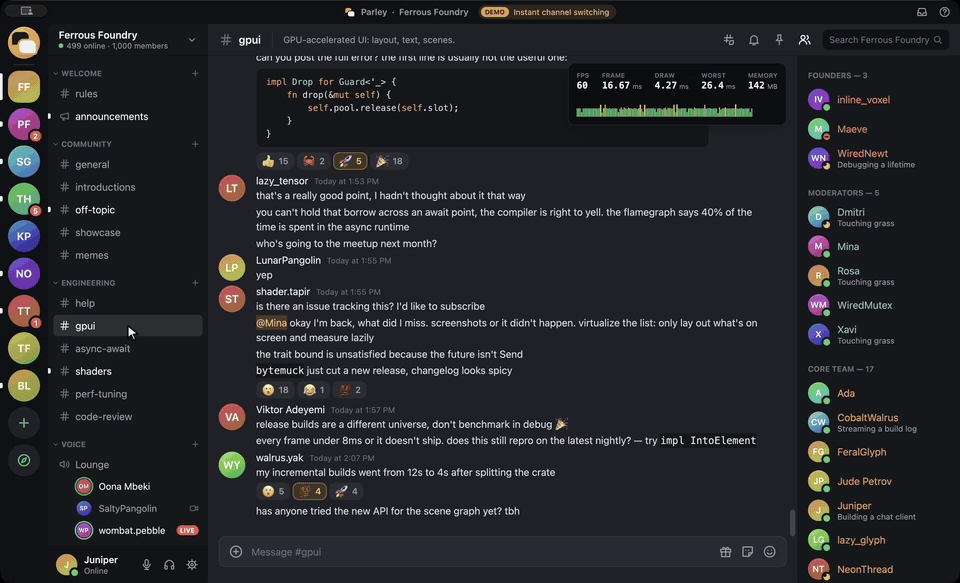
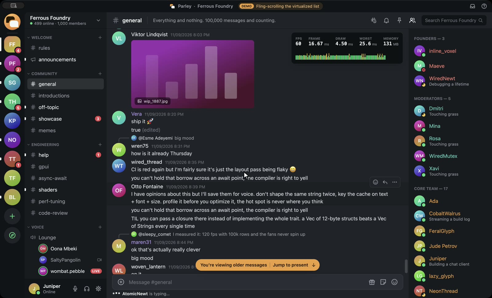
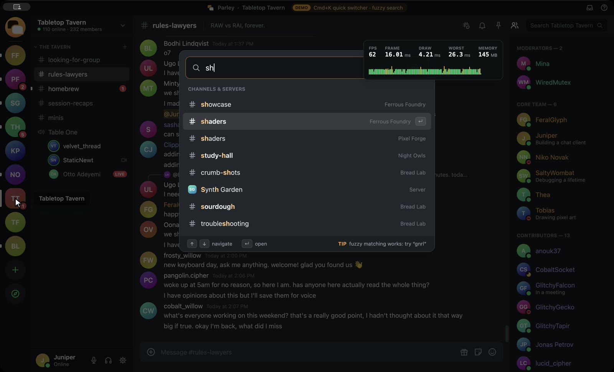
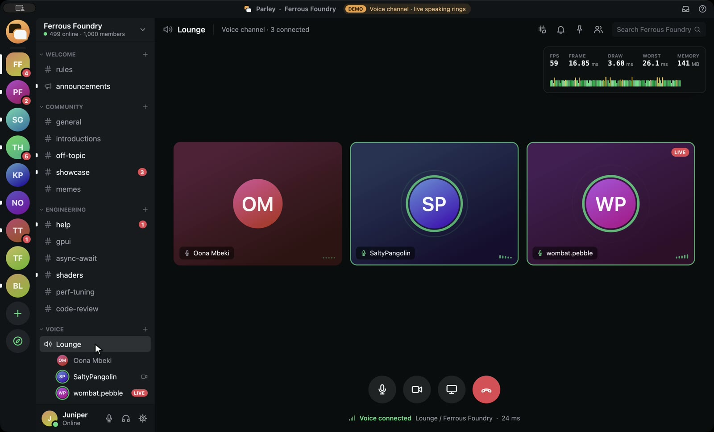
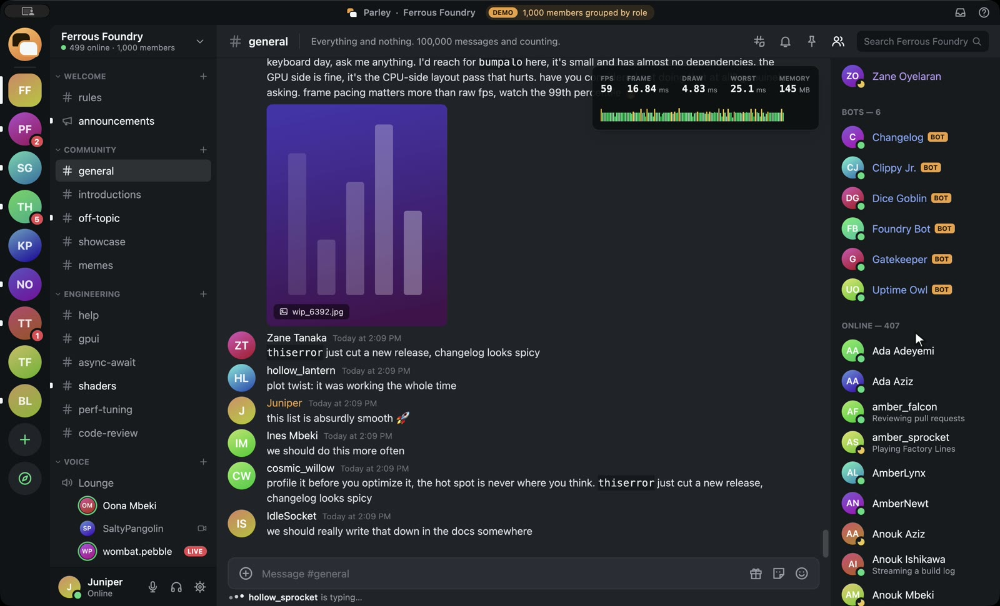

# parley

A Discord-style chat app in **Rust + [GPUI](https://www.gpui.rs)**, written by **Claude Fable 5.2** in Claude Code from one prompt in **44 minutes**. No human wrote any of the app code.



Discord [announced](https://x.com/WumpusCentral/status/2118106749446103371) on Nov 4, 2026 that it is rebuilding its desktop app in Rust on GPUI, the UI framework from Zed. This repo is what one model built on the same stack in one sitting.

**Parley is not Discord** and has nothing to do with it. It contains no Discord code or assets, and it never connects to Discord. It is a **UI only** app: offline, with no network and no real voice. Every server, member and message is generated locally when it starts. The model invented the name, logo and palette.

## Numbers

| | |
|---|---|
| wall-clock time of the run | 43 min 45 s |
| agent steps | 189 |
| Rust written | 5,378 lines in 13 files |
| lines written before the first real compile | 5,126 (1 compile error) |
| first time the model looked at its own window | minute 27 |
| release binary | 6.7 MB |
| memory with 100,000 messages loaded | 118–146 MB (`ps` RSS, Apple M4, during the demo) |
| frame time | ~4 ms of draw time per frame, 60 fps on a 60 Hz display |

## What's in it

- A server rail with unread and mention badges, and a channel list with categories.
- A voice channel whose speakers have pulsing rings.
- **100,000 messages** in `#general` in a virtualized list. It supports fling scrolling, a draggable scrollbar with a date label, and "jump to present".
- Messages are grouped by author and can contain replies, reactions, code blocks, mentions and image placeholders.
- A working composer: type a message, press Enter, and it appears.
- A member list of about 1,000 people grouped by role.
- **Cmd+K** quick switcher with fuzzy search.
- `--demo` plays a 45-second tour by itself and draws its own cursor. `--hud` shows fps, frame time and memory.

[NOTES.md](NOTES.md) is the model's own list of what works and what doesn't. In short, there is no text selection or copying, links aren't clickable, and some buttons are only for show.

| | |
|---|---|
|  |  |
|  |  |

## Run it

You need macOS, Rust and the Xcode Command Line Tools. The full Xcode app isn't required, because the `runtime_shaders` feature compiles Metal shaders when the app starts.

```sh
cargo build --release
./target/release/parley              # use it
./target/release/parley --demo --hud # the self-playing tour with the perf overlay
```

## How it was made

The model got [PROMPT.txt](PROMPT.txt) and an empty folder with one helper, [snap.sh](snap.sh). `snap.sh` builds the app, opens it without taking focus, and screenshots only its window with a small ScreenCaptureKit tool ([tools/wincap](tools/wincap/main.swift)). That was the model's only way to see its work.

Its tools were limited to reading and writing files, `cargo`, `git` and `./snap.sh`. The commit history is the model's own.

To repeat the run in an empty folder that contains `snap.sh` and `tools/`:

```sh
claude -p --model claude-fable-5-2 --permission-mode acceptEdits \
  --allowedTools "Write,Edit,Read,Glob,Grep,Bash(cargo:*),Bash(git:*),Bash(./snap.sh:*),Bash(ls:*),Bash(mkdir:*)" \
  < PROMPT.txt
```

After the run, the only changes were this README, the `docs/` media, and moving the screenshot tool into `tools/`.

MIT licensed. By [@masamunecode](https://x.com/masamunecode).
